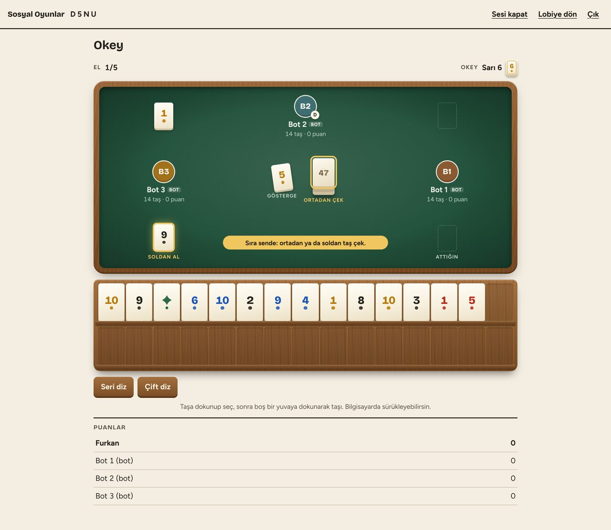
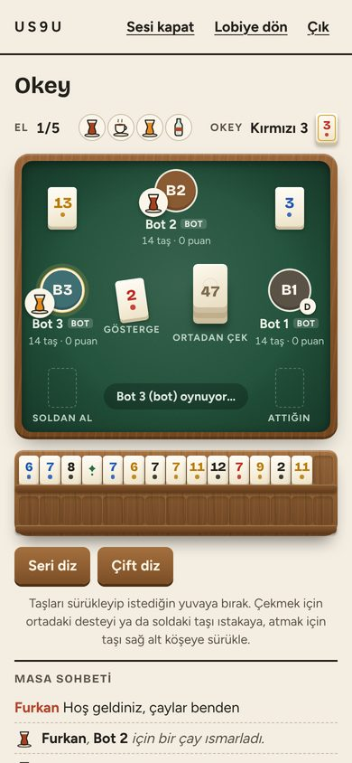
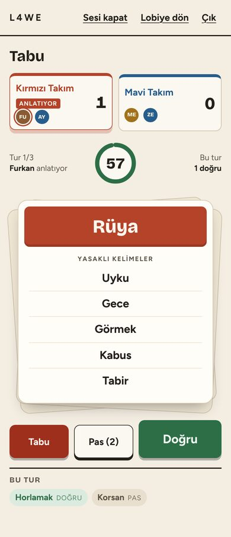
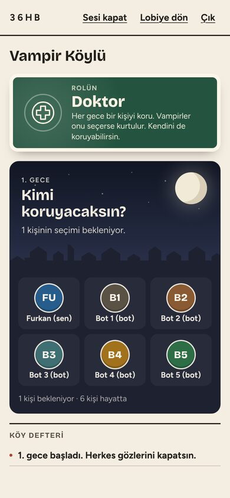
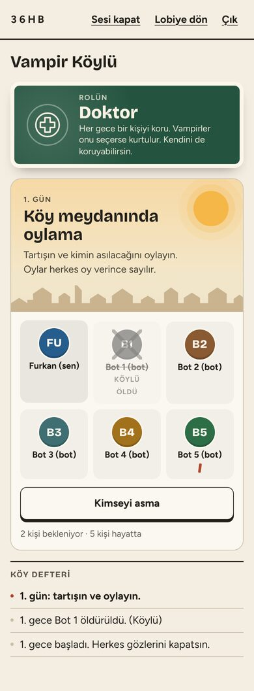
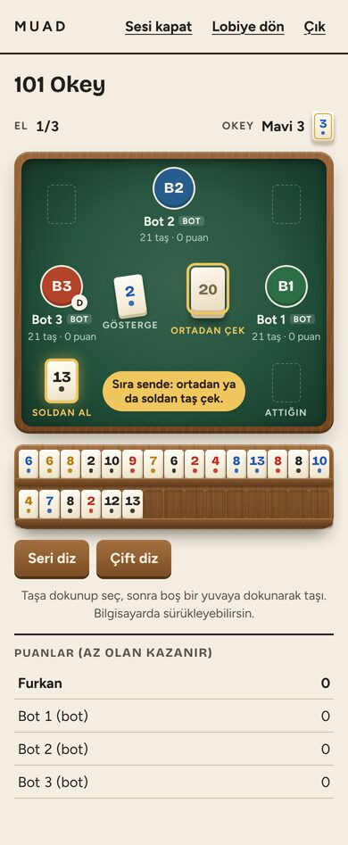
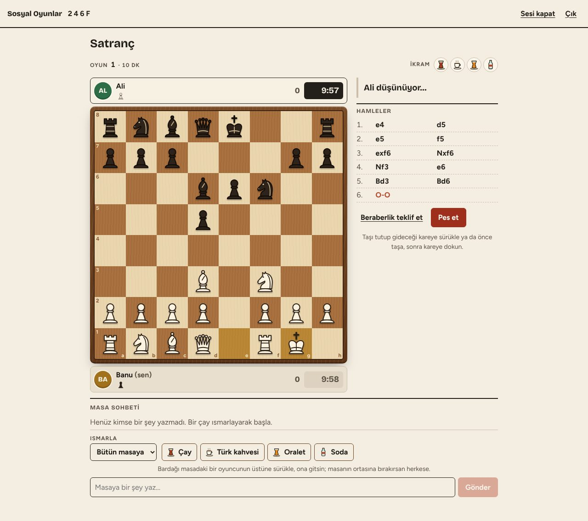

# Sosyal Oyunlar

Arkadaş grubuyla tarayıcıdan oynanan masa ve grup oyunları. Biri oda açar, 4 haneli oda kodunu ya da davet linkini paylaşır, herkes kendi telefonundan veya bilgisayarından katılır. Kurulum, hesap ya da uygulama indirmek gerekmez.

**Oyna:** [socialgames-rm61.onrender.com](https://socialgames-rm61.onrender.com)

<p>
  
  
</p>

## Oyunlar

| Oyun | Oyuncu | Bot | Kısaca |
| --- | --- | --- | --- |
| Tabu | 4-16 | Yok | İki takım. Anlatıcı ve rakip takım kartı görür, anlatıcının takımı tahmin eder. Doğru +1, Tabu -1, tur başına 3 pas. |
| Vampir Köylü | 4-16 | Var | Her 4 kişiye 1 vampir, 1 gözcü, 5 ve üzeri kişide 1 doktor. Gece vampirler ısırır, doktor korur, gözcü bakar; gündüz köy oylar. |
| Okey | 4 | Var | 106 taş, gösterge ve okey. Seri ya da per ile, veya 7 çiftle bitir. Normal bitiş +2, çiftten ya da okey atarak bitiş +4. Normal ya da katlamalı oynanır. |
| 101 Okey | 4 | Var | 101 sayıyla ya da 5 çiftle el aç, masadaki gruplara işle. Yandan alınan taş o el kullanılmalı. Bitiren -101, açamayan 202 ceza alır. Çiftten ya da okeyle bitişte cezalar iki katı. Az puan kazanır. |
| Satranç | 2 | Var | Tam kurallar: rok, geçerken alma, terfi, mat, pat, üç tekrar, 50 hamle, yetersiz taş. Satranç saati, hamle başı ek süre, beraberlik teklifi, renk değiştiren rövanş. Kolay, orta ve zor bot. |

<p>
  
  
  
  
</p>



## Özellikler

- **Oda sistemi.** Oda kodu ya da `?oda=KOD` linkiyle katılım. Oda sahibi oyunu seçer, ayarları yapar, oyuncu çıkarabilir. Bir oyun bitince aynı odada başka bir oyuna geçilir.
- **Botlar.** Eksik koltuklara bot eklenebilir; bağlantısı kopan oyuncunun yerine 15 saniye sonra bot geçer, oyuncu dönünce koltuğunu geri alır. Satrançta bot seviyesi seçilir (kolay, orta, zor).
- **Masa sohbeti ve ikram.** Oyun ekranının altında sohbet var. Çay, Türk kahvesi, oralet ya da soda bir oyuncunun koltuğuna sürüklenerek ısmarlanır, masanın ortasına bırakılırsa herkese gider.
- **Oyun ayarları.** Tabu'da tur süresi ve tur sayısı; Okey'de oyun türü (normal ya da katlamalı), el sayısı, başlangıç puanı, gösterge puanı ve hamle süresi; 101'de el sayısı ve hamle süresi; satrançta kişi başı süre ve ek süre. Hamle süresi dolan oyuncunun hamlesini bot yapar.
- **Okey ıstakası.** Taşlar sürükle bırak ile dizilir (telefonda dokunarak da), seri ve çift dizme düğmeleri, eldeki taşların puan sayacı, renk körü modu (renkler ayrıca şekille gösterilir).
- **Telefona uygun.** Bütün ekranlar telefon genişliğinde de oynanacak şekilde tasarlandı. Ses efektleri tek tuşla kapatılabilir.
- **Gizli bilgi sunucuda.** Eller, roller ve kartlar sunucuda tutulur; her oyuncuya sadece görmesi gereken gönderilir, tarayıcıdan bakarak kopya çekilemez.

## Yerelde çalıştırma

Node.js 22 gerekir.

```bash
npm install
npm run dev        # sunucu :3001, arayüz :5173
```

Tarayıcıda `http://localhost:5173` adresini aç. Aynı odaya birden fazla oyuncuyla girmek için farklı tarayıcı pencereleri (ya da gizli pencere) kullanabilirsin.

```bash
npm test           # oyun kuralları ve oda testleri
npm run typecheck  # sunucu ve arayüz tip denetimi
npm run build      # arayüzü derler
npm start          # derlenmiş arayüzü sunucuyla birlikte tek portta çalıştırır
```

## Proje yapısı

```
server/   Node, Express, Socket.IO. Odalar, botlar ve bütün oyun kuralları.
  src/games/<oyun>/   Her oyunun kuralları ve botu
  test/               Vitest testleri
client/   React ve Vite ile yazılmış arayüz
  src/games/          Her oyunun ekranı ve stili
shared/   Sunucu ile arayüzün ortak tipleri ve mesaj protokolü
```

**Yeni oyun eklemek:** `server/src/games/` altına `GameDefinition` uygulayan bir modül, `shared/games/` altına görünüm tipleri, `client/src/games/` altına ekranı ekle ve oyunu `shared/protocol.ts` içindeki `GAMES` listesine kaydet. Ayarı varsa `client/src/Lobby.tsx` içindeki ayar listesine ekle.

## Yayına alma (Render, ücretsiz)

Canlı sürüm Render'ın ücretsiz planında çalışıyor ve `main` dalına her birleştirmede kendiliğinden yeniden kuruluyor.

Kendi kopyanı yayına almak için:

1. Bu depoyu fork'la ve [render.com](https://render.com) üzerinde GitHub hesabınla giriş yap.
2. **New, Blueprint** seç ve depoyu bağla. `render.yaml` derleme ve başlatma komutlarını ayarlar.
3. Kurulum bitince verilen `https://<isim>.onrender.com` adresini arkadaşlarınla paylaş.

Ücretsiz planda sunucu 15 dakika boş kalınca uyur, ilk giriş yaklaşık bir dakika sürebilir. Odalar bellekte tutulur, sunucu yeniden başlarsa açık odalar kapanır. GitHub Pages ya da Netlify gibi statik barındırma yetmez, çünkü oyunlar gerçek zamanlı bir sunucuya ihtiyaç duyar.
